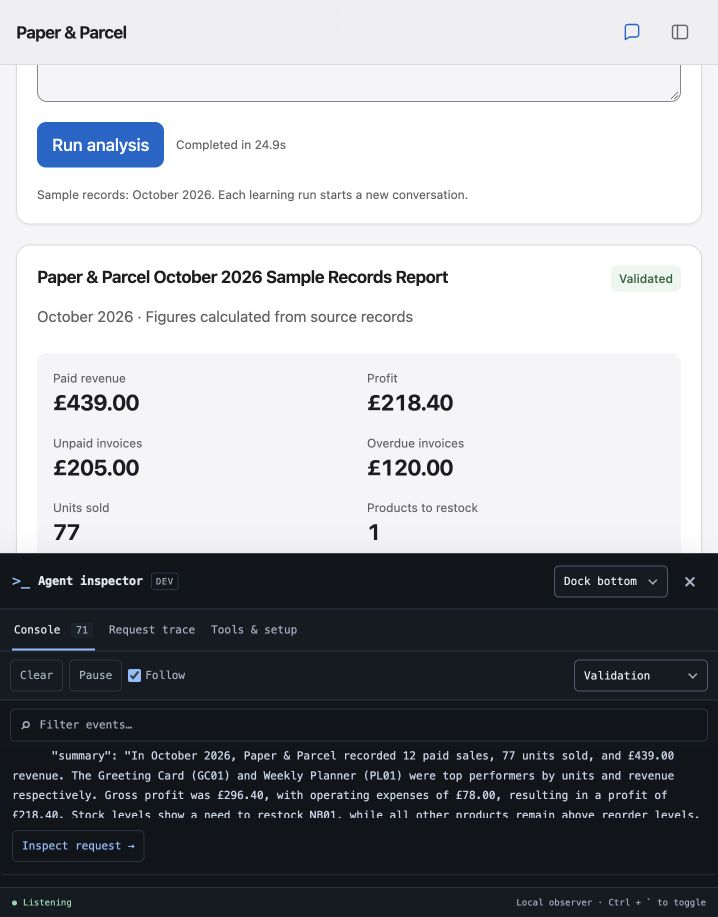

# Paper & Parcel

A fictional online stationery shop for learning how a Python LangChain agent
connects to a backend API and a web frontend. All customers and transactions are
invented. Currency: GBP. Demo date: **3 November 2026**.

## Run the finished app

Install **Python 3.12** and **Ollama**, then clone and set up the project:

```bash
git clone https://github.com/elenichas/paper-and-parcel.git
cd paper-and-parcel
python3.12 -m venv .venv
.venv/bin/python -m pip install -r requirements.lock.txt
sh scripts/start_app.sh
```

On macOS with Homebrew, the prerequisites can be installed with
`brew install python@3.12 ollama`. Once setup is complete, run
`sh scripts/start_app.sh` from the project folder to start the app again.

Open **http://127.0.0.1:8000** in Chrome. This command starts Ollama if needed,
checks that the local model is downloaded, and starts the Python web server.
Press Ctrl+C in its terminal to stop the app. A pre-existing Ollama process is
left running; an Ollama process started by this launcher is stopped with the app.

The app includes overview, sales/profit, inventory, and invoice views; a chat
assistant with recent conversation context. The **How it works** view explains
the full flow. Select **Inspect** or **Developer tools** to open a separate dark
developer drawer alongside the app, without leaving the current view or chat.
It records actual API activity, model calls, tool data and validation.
The **Learning lab** adds an October report chain, a SQLite agent, pandas charts,
and an explicit LangGraph workflow. Each action shows its real inputs, outputs,
model/tool decisions and Pydantic validation alongside the frontend result.
Sales charts also work in the ordinary chat. Ask for October revenue by product,
daily revenue, or units sold by product. An unclear graph request offers three
clickable chart choices. The chat renders the actual validated pandas results.
See the [Learning Lab walkthrough](docs/learning-lab.md) for the course concept
map, example questions and terminal tracing commands.
Everything in this demo runs locally using fictional CSV records and the
downloaded model. No external financial service or paid model API is connected.
The model download and local Python environment are not part of this repository.



Try these questions:

- "How did we do in October? Give me revenue and profit."
- "Which products should we restock?"
- "Who has overdue invoices?"
- "Which product brought in the most revenue?"
- "What was September revenue?" — the assistant should explain that only October is available.

If rebuilding the Python environment later:

```bash
python3.12 -m venv .venv
.venv/bin/python -m pip install -r requirements.lock.txt
```

`requirements.txt` lists direct dependencies; `requirements.lock.txt` records
the exact installed versions. The app uses LangChain 1.4.8, its Ollama integration
1.1.0, and FastAPI 0.162.0.

## Our learning steps

Steps 1–3 were built and discussed individually. At your request, steps 4–6 were
then completed together and the app was started locally.

1. **Shop and data — complete.** Create the records and check the numbers with Python.
2. **Local AI model — complete.** Set up Ollama and a suitable model on your M2 Mac; send it a message. Prepare a supported Python version and an isolated project environment.
3. **Business tools — complete.** Write Python functions to answer questions about sales, expenses, invoices, and stock.
4. **LangChain agent — complete.** Connect the model to those tools and inspect how it chooses and calls them.
5. **Backend API — complete.** Add a FastAPI endpoint that receives a message and calls the agent.
6. **Web frontend — complete.** Build a dashboard and chat interface, then try the complete flow in Chrome.
7. **Optional future extension.** Replace a sample-data tool with a Stripe sandbox integration. The finished local demo does not require this integration.

Steps 1–6 are designed to run locally without paid model APIs or hosting.

## Step 1: what we have

```text
data/
  products.csv     Product prices, costs, and stock at the start of October
  sales.csv        Paid October sales, one product per row
  expenses.csv     October operating expenses
  invoices.csv     Separate unpaid wholesale invoices
scripts/
  inspect_shop.py  Reads the records and prints a checked business summary
```

CSV means comma-separated values: a simple table stored as a text file. The first
line names the columns; each following line is a record. These files are our first
data store. A database can replace them later.

Run the first script from this project folder:

```bash
python3 scripts/inspect_shop.py
```

It uses only Python's standard library, so step 1 needs no installations, accounts,
API keys, or model downloads.

## What the figures mean

- Revenue counts paid sales in October only.
- Cost of goods sold is the quantity sold multiplied by each sale's recorded unit cost.
- Demo profit is revenue minus cost of goods sold minus operating expenses.
- Unpaid invoices are separate from the paid sales and excluded from this profit calculation.
- An invoice is overdue if its due date is before the demo date and it remains unpaid.
- Stock is opening stock minus paid quantities sold. No restocks or returns occurred in this sample. Unpaid wholesale invoices have not been shipped or deducted from stock.
- A product needs restocking when stock is at or below its reorder level.

This is a simplified learning model: VAT, refunds, depreciation, and other accounting
adjustments are outside the sample.

## Checked answers for our future agent

| Question | Expected answer |
| --- | --- |
| October revenue | £439.00 |
| Cost of goods sold | £142.60 |
| Operating expenses | £78.00 |
| October demo profit | £218.40 |
| Best seller by units | Greeting Card, 22 units |
| Best seller by revenue | Weekly Planner, £144.00 |
| Unpaid invoices | £205.00 |
| Overdue invoices on 3 November | Studio Fern, £120.00 |
| Product needing restock | Dotted Notebook, 5 left |

The inspection script performs fixed calculations. The agent in step 4 will add a
model that interprets a question and chooses which Python tools to use; the tools
will calculate the business figures.

## Step 2: the local AI model

There are three new pieces:

- **Ollama** is the program that loads and runs the AI model on this Mac.
- **Qwen3 4B Instruct** is the downloaded model: the part that reads messages and generates replies. Its download is about 2.5 GB; running it uses additional memory. We use the instruction-following variant for direct answers.
- **`.venv`** is this project's Python 3.12 environment. Future Python packages will be installed here, keeping the project's dependencies together.

Ollama and Python 3.12 were installed using Homebrew. The model files are stored
in `~/.ollama/models`, outside this project's source files. This setup runs the
downloaded model locally; it needs no paid model API or account.

### How Python talks to the model

`scripts/chat_local.py` sends an HTTP request to
`http://127.0.0.1:11434/api/chat`. The address `127.0.0.1` means **this computer**.
Ollama listens there, passes the message to Qwen3, and returns the generated reply
as JSON, a structured text format that Python can read.

The request includes two messages:

1. A **system message** describes the assistant's role at Paper & Parcel.
2. A **user message** contains the question we want it to answer.

We request a short answer and a 4,096-token context window to keep memory use
modest. Tokens are the pieces of text the model processes. Each invocation starts
a fresh conversation; chat history will be a later application feature.

At step 2, the model knows only the shop description we put in the system message.
Business records remain in our CSV files. In steps 3 and 4, tools will connect
those records to the agent so it can answer questions using actual sample data.

### Verified on this Mac

- Ollama 0.35.0; project Python 3.12.15.
- Model: `qwen3:4b-instruct`, ID `0edcdef34593`.
- Ollama reported 100% GPU execution, about 3.2 GB loaded, and a 4,096-token context.
- The introduction completed in about 3 seconds, including model loading: "Hi! I'm Paper & Parcel — your friendly shop for notebooks, planners, pens, stickers, and cards."
- Asked "What was our October revenue?", it explained that it did not have access to the records. That request completed in about 1.2 seconds.
- Step 1's inspection script also ran successfully in the new Python environment.

These timings are observations from two short requests; longer conversations and
tool use will take more time. The model handled these examples correctly, but
tools and application checks will still be needed for dependable business answers.

### Run it again

The assistant handles these commands during our sessions; they are recorded here
so you can see and reproduce the process.

Start the local server in one terminal:

```bash
sh scripts/start_ollama.sh
```

The startup script disables cloud features, binds to this computer only, and
limits concurrent model use. It runs for the current session rather than
installing an automatic login service. If Ollama is already running on port
11434, use the existing server instead of starting a second copy.

In another terminal, send a message:

```bash
.venv/bin/python scripts/chat_local.py
.venv/bin/python scripts/chat_local.py "What does a stationery shop sell?"
```

Download the model again only if it is missing:

```bash
ollama pull qwen3:4b-instruct
```

Press Ctrl+C in the server terminal to stop Ollama. Models unload from memory
after five idle minutes while the server is running; the downloaded files stay
on disk for the next session.

References: [Ollama on macOS](https://docs.ollama.com/macos),
[Qwen3 4B Instruct](https://ollama.com/library/qwen3:4b-instruct),
[chat API](https://docs.ollama.com/api/chat),
[local-only mode](https://docs.ollama.com/faq#how-do-i-disable-ollamas-cloud-features).

## Step 3: business tools

The four functions live in `shop/tools.py`. A tool starts as an ordinary Python
function: it has a name, takes inputs, reads data or performs a calculation, and
returns a result. We run the functions directly in this step. In step 4, LangChain
will expose their names, input types, and descriptions to the model and execute
the tools it selects.

| Function | Example input | What it returns |
| --- | --- | --- |
| `get_sales_summary` | `month="2026-10"` | Paid revenue, quantities, product breakdown, best sellers by units and by revenue |
| `get_profit_summary` | `month="2026-10"` | Revenue, sold-product costs, gross profit, operating expenses, and demo profit |
| `get_unpaid_invoices` | `overdue_only=True` | Overdue invoices as of the fixed demo date, 3 November 2026 |
| `get_stock_status` | `low_stock_only=True` | Products needing restock after October sales, as of 31 October 2026 |

For the last two functions, omit the input or use `False` to get all unpaid
invoices or all products. `True` asks for the filtered list.

### Example: call the profit tool

```python
from shop.tools import get_profit_summary

result = get_profit_summary(month="2026-10")
print(result["profit_gbp"])  # 218.40
```

`month` is an **argument**: a named input to the function. `result` is a Python
**dictionary**, containing named values such as `revenue_gbp` and `profit_gbp`.
It can be converted to JSON for the model and our future frontend.

Money is calculated using Python's `Decimal` type rather than binary floating-point
numbers. The tool returns amounts as strings such as `"218.40"` to preserve their
exact decimal representation in JSON.

### Run all four tools

```bash
.venv/bin/python -m shop.demo_tools
```

This executes `shop/demo_tools.py`, prints each function call, and displays its
actual JSON result. The `-m` option runs a Python module from this project.

Verified results:

- Paid October revenue: **£439.00**, across 77 units and 12 sale records.
- Best seller by units: **Greeting Card, 22 units**.
- Best seller by revenue: **Weekly Planner, £144.00**.
- October demo profit: **£218.40**.
- All unpaid invoices: **£205.00**; overdue subset: **£120.00** owed by Studio Fern, nine days late on the demo date.
- Restock: **Dotted Notebook, five remaining**, below its reorder level of eight.

Only October monthly data is available. Asking for another month raises an
explanatory error rather than implying that the shop had zero sales. Invoice
status uses the fixed demo date; stock uses the end-of-October snapshot.

### Checks completed

```bash
.venv/bin/python -m unittest discover -s tests -v
```

All six tests in `tests/test_tools.py` passed. They cover known business answers,
unavailable months, and an independent temporary dataset that checks exact money
calculations, historical sale costs, tied best sellers, paid invoice exclusion,
due-date boundaries, and the stock reorder threshold. The temporary data is
separate from our shop's CSV files.

## Step 4: the LangChain agent

`shop/agent.py` connects `ChatOllama` to the four business functions using
LangChain's `create_agent`, plus two pandas chart tools and a `redirect_to_shop` guidance function. Its system prompt describes the shop, the fixed demo
date, the available data, and the need to consult records for business answers.

```text
User question → model chooses tool → Python executes tool
                       ↑                     ↓
                       └──── tool result ────┘
                               ↓
                       model writes answer
```

The agent can call several tools for one question. A question about October's
performance was verified to call both the sales and profit tools. A combined
stock/invoice question called both corresponding tools.

Business answers are withheld if the model skips record lookup. The backend
asks it to verify using a tool once; if it still skips the tools, it returns an
error instead of exposing the unverified draft. This addresses a follow-up test
where the small model initially invented a product. This check establishes that
a tool ran; it does not mathematically verify every sentence of a generated
answer. The expandable tool cards let you inspect the source facts.

### Requests outside the shop's scope

A separate local model call in `shop/scope.py` returns a structured route before
the shop agent runs: shop, chart, chart clarification, outside scope, unsupported
action, capabilities, or small talk. For unsupported topics or actions, the app calls `redirect_to_shop`
directly and returns its wording and three clickable questions. This is a normal
successful response, not a server error, and accesses no shop records. It does
not depend on the main agent remembering to select a guidance tool.

The inspector shows the scope check, selected route, and app guidance separately
from model-selected business tools. Model-call counts include the scope check.
The guidance function is also available to the shop agent for mixed requests.
This adds one short local model call to each request; there are no paid API calls.

Every non-greeting request must use a business tool or the guidance tool. If the
model skips both, its draft is withheld and retried once. Scope selection is
still a model decision, not a guarantee of correct classification. A request for
a missing month remains a business question: the relevant tool returns an
explanation that those records are unavailable. For mixed questions, the model
is instructed to answer the supported part and explain the unsupported part.

Run the agent directly:

```bash
.venv/bin/python -m shop.demo_agent "What was our October profit?"
```

This prints the actual model-selected tool, its input, its result, and the final
answer. The earlier `scripts/chat_local.py` remains a model-only learning example;
the web app uses the full agent.

## Step 5: the backend

`shop/server.py` serves both the frontend files and these endpoints:

| Endpoint | Purpose |
| --- | --- |
| `GET /api/dashboard` | Get real sample-data calculations and sale records |
| `GET /api/health` | Check that Ollama is reachable and the model is installed |
| `GET /api/agent` | Inspect the registered tool schemas, data sources, model settings, and app instructions |
| `POST /api/chat/stream` | Stream agent status, tool calls/results, and the answer |
| `POST /api/chat` | Get the same answer and tool trace in one JSON response |
| `GET /docs` | Interactive FastAPI documentation |

Chat accepts `message` and an optional list of recent `history` entries with
`role` and `content`. The browser sends up to six recent messages; the backend
limits input size and trims context. Conversations are browser-memory only and
reset on page reload or **Start a new conversation**. The model processes one
app request at a time to keep memory use modest, and long requests time out.

## Step 6: the frontend

`web/index.html`, `web/styles.css`, and `web/app.js` implement the responsive
dashboard and chat with no JavaScript build step or external asset downloads.
The dashboard calls the backend with `fetch`; the chat reads streamed events
and displays expandable tool evidence before the completed answer.

The chart switches between revenue and units, navigation opens the corresponding
records, Refresh reloads the CSV-based calculations, and the chat supports quick
questions, follow-ups, stopping a response, retrying, and starting a new chat.

### Interface and accessibility

The frontend adapts Apple's Human Interface Guidelines for the web. It uses the
platform system font, a neutral sidebar, a restrained blue accent, readable text,
and familiar controls. Appearance follows the system by default; **Appearance**
in the navigation can select Light or Dark and remembers the choice locally.
On smaller screens, the navigation button reveals the menu and an assistant
shortcut focuses the chat. Business tables scroll inside their own regions.

Keyboard focus, a skip link, descriptive button names, table captions and column
headers, 44-pixel touch targets, and text labels for status improve accessibility.
CSS respects reduced motion, reduced transparency, increased contrast, and forced
colors where the browser supports those preferences. Text uses relative font
sizes so browser text sizing and zoom can enlarge it. This is a web adaptation,
not a native SwiftUI interface; full VoiceOver and device testing remain outside
the automated checks.

Guidance: [Accessibility](https://developer.apple.com/design/human-interface-guidelines/accessibility),
[Typography](https://developer.apple.com/design/human-interface-guidelines/typography),
[Layout](https://developer.apple.com/design/human-interface-guidelines/layout),
[Materials](https://developer.apple.com/design/human-interface-guidelines/materials),
and [Buttons](https://developer.apple.com/design/human-interface-guidelines/buttons).

### Application verification

```bash
.venv/bin/python -m unittest discover -s tests -v
node --check web/app.js
.venv/bin/python -m pip check
```

All 42 automated tests passed. These include the original financial/date checks,
HTTP input validation, JSON/stream responses, history handling, and regression
checks that withhold unsupported drafts, redirect unrelated questions after shop
history, offer alternatives for unsupported actions, and preserve missing-data
responses. The HTTP unit tests use a simulated
agent; separate real-model checks exercise the local Ollama connection and actual
tool decisions. Chrome checks cover the dashboard views, chart control, chat,
tool evidence, follow-ups, and a 390-pixel mobile layout.

Learning Lab checks additionally cover SQL totals and read-only enforcement,
bounded query results, database rebuilding, pandas product/daily aggregates,
chart invariants, real sequence/parallel graph execution, withheld invalid
structured output, conditional guidance routing, and the learning SSE API.
Real-model checks are separate from these deterministic unit tests.

### Agent inspector

Open **Inspect** at the bottom right, **Developer tools** in the navigation, or
press **Ctrl + `**. The drawer is a separate developer surface, not a shop page.
Dock it right or below the app; narrow windows automatically use the bottom.
Drag its divider, or focus the divider and use the arrow keys, to resize it.
Close it without losing the conversation or request history. Its dark theme is
independent of the shop appearance.

**Console** shows real API fetches and backend-streamed agent events in order.
Filter by category or text, pause display updates while recording continues,
or turn off Follow to read earlier events. Expanding an agent row reveals its
JSON and an **Inspect request** link to the matching trace. **Clear** clears the
console display, keeping request traces. The console retains up to 600 entries.
Row times are seconds since page load; expanded agent events also contain the
backend request ID and elapsed time. Dock size, position, open state and selected
developer view are remembered locally across reloads.

**Request trace** uses the same streamed events as the chat and Learning Lab;
it does not simulate a separate agent or make extra model calls. Each new
question creates a request with a backend-generated ID and event timestamps.
**Tools & setup** shows actual registered functions and model instructions.
Together, these views show:

- The message and trimmed conversation actually passed to the agent.
- Model calls and reported token usage when the model supplies it.
- Model-selected function names and arguments, returned JSON, and tool errors.
- The data sources declared for each function.
- Verification retries, the final answer, and stopped or failed requests.
- The available tool schemas and this app's system prompt/model configuration.

Select earlier runs from **Inspect a request**, or use **Export JSON** to keep
a trace. The last 12 requests are kept in this tab's memory until a page reload;
starting a new chat clears the conversation while keeping those inspection runs.
Recording starts when the page loads, including while the drawer is closed.
Reloading the page clears its browser memory. API rows time response headers;
streamed events show the subsequent work and final request duration. This is a
viewer for this browser page's activity, not a shell or a server-wide log viewer.

Backend timestamps measure when events were emitted, not Python CPU execution
time. Parallel tool results are grouped into one subsequent model call. The
inspector shows observable execution and returned records, not hidden model
reasoning or unverified answer drafts.

References: [LangChain agents](https://docs.langchain.com/oss/python/langchain/agents),
[Ollama integration](https://docs.langchain.com/oss/python/integrations/chat/ollama),
[agent streaming](https://docs.langchain.com/oss/python/langchain/streaming).
