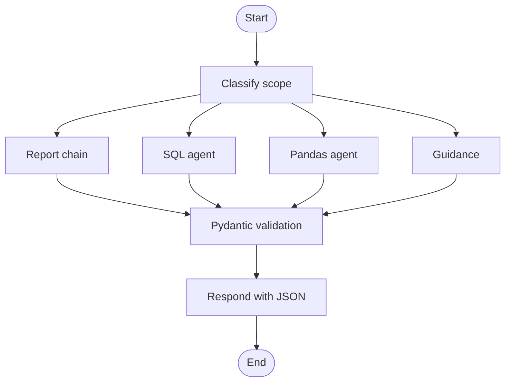

# Learning Lab: course concepts in the running shop

Open http://127.0.0.1:8000/#learning-lab while the app is running. Each action
produces a frontend result and a trace of the actual backend execution. The
ordinary shop chat remains available from the other workspace views.
Select **Inspect execution** to open the independent developer drawer. The app
stays visible as the console records API, model, graph, tool and schema events.
Use **Request trace** for expanded steps and **Tools & setup** for schemas and
instructions. The drawer also works across all the ordinary shop views.
The ordinary chat also has the two pandas tools. A vague request such as
“create a graph to show me” offers chart choices, and selecting one produces an
inline chart from a validated `ChartResult`. Its tool calls, validation and final
JSON are visible in the normal Agent inspector. The authored report/SQL/chart
StateGraph described below runs in the Learning Lab.

## 1. Report chain

Select **Report chain**, then **Run analysis**.

The report uses a real `RunnableSequence` in `shop/learning.py`:

```text
RunnableLambda: prepare October request
                   ↓
RunnableParallel: sales | profit | stock | invoices
                   ↓  wait for every branch
RunnableLambda: join facts, generate ReportNarrative, build ReportResult
```

The parallel branches perform independent Python record reads concurrently; they
are not four simultaneous model calls. The model runs after the join. Look for
the branch start/end events and their returned records in the inspector.

The model call uses:

```python
model.with_structured_output(
    ReportNarrative, method="json_schema", include_raw=True
)
```

Expand **ReportNarrative · JSON parsing** to compare the model's actual response,
the parsed Pydantic object, and its JSON schema. The monetary metrics are supplied
by the business calculations, not extracted from the model's prose.

Expected source metrics: £439.00 revenue, £218.40 profit, £205.00 unpaid invoices,
£120.00 overdue, 77 units sold, and one product needing restocking.

## 2. SQL agent

Select **SQL agent** and try:

- Which products generated the most revenue in October?
- Which invoices are overdue, and how much is owed?

`shop/database.py` builds `.runtime/shop.sqlite` from the four CSV fixtures. The
snapshot is rebuilt when those fixtures change. It contains `products`, `sales`,
`expenses`, and `invoices`. Monetary columns store integer pence.

The LangChain agent can choose these tools:

1. `list_shop_tables`
2. `describe_shop_tables`
3. `query_shop_database`

Watch its selected arguments, SQL, results, and any query errors in the trace.
The frontend shows the executed queries and their actual result tables. For
example, a revenue query will use `SUM(quantity * unit_price_pence) / 100.0`.

This is a LangChain SQL agent using our own small SQLite tools, rather than the
larger `SQLDatabaseToolkit`. SQLite opens the query connection read-only. An
authorizer restricts access to the shop tables and allowed read functions; queries
have a time limit and return at most 100 rows. No payment or write tools exist.

## 3. Pandas analysis and charts

Select **Pandas charts** and try:

- Show October revenue by product as a bar chart.
- Show daily October revenue as a line chart.
- Compare October units sold by product.

The LangChain agent chooses tools in `shop/analysis.py`:

- `describe_sales_dataframe`: inspect columns, types, row count and sample rows.
- `aggregate_sales`: select grouping, metric and chart type.

Python actually uses pandas to read, merge, group, sum and sort the records.
Money is aggregated in integer pence before conversion to chart GBP values.
The resulting `ChartSpec` is validated by Pydantic. Its labels and values must
match, values must be finite and nonnegative, and line charts must use dates.

The browser draws the validated values as bars or an SVG line chart. Expand
**Chart data and pandas operation** to compare the chart with its source values.
Dates without a recorded sale are not added. Only October 2026 is available.

This is a pandas-backed tool-calling agent, not an unrestricted Python REPL or
the `create_pandas_dataframe_agent` helper. The model chooses a defined operation;
it does not execute arbitrary generated Python or generate the SVG markup.

## 4. Explicit LangGraph workflow

All three Learning Lab actions run through our authored `StateGraph`:



The UI selects the desired feature. The scope decision determines whether the
graph continues to that feature or follows the guidance edge. The displayed
graph is populated from the compiled graph's nodes/edges, and highlights nodes
only when actual execution events arrive. This graph is additional to the agent
loop LangChain builds internally for SQL and pandas tool calling.

## 5. JSON and validation at different boundaries

These are distinct steps, and the trace exposes them separately:

- FastAPI validates `LearningRequest` before running anything.
- The scope model returns a Pydantic `ScopeDecision`.
- The report model's JSON is parsed and validated as `ReportNarrative`.
- SQL results and chart data use typed result models.
- The graph's `validate` node checks the final discriminated `LearningResult`.
- The server serializes the validated object as JSON in its event stream.
- JavaScript parses that JSON and renders the report, table or chart.

Validation checks the contract and relevant invariants; it does not establish
that every sentence of a model-written summary is true. Compare prose with the
returned records. Failed validation withholds the result rather than inventing
replacement data. Tool lookup is required before SQL/chart answers are accepted.

## 6. Terminal logging

The server prints the same observable events that reach the inspector. Each
event has a request ID and elapsed time. Full events are also saved in the local,
size-limited `.runtime/events.jsonl` log (with two rotated backups).

From the project directory, view the running server's events:

```bash
tail -f .runtime/events.jsonl
```

Or run one workflow directly from the terminal:

```bash
.venv/bin/python scripts/trace_learning.py report "Generate the October 2026 shop report."
.venv/bin/python scripts/trace_learning.py sql "Which products generated the most revenue in October?"
.venv/bin/python scripts/trace_learning.py chart "Show daily October revenue as a line chart."
```

Set `SHOP_TRACE=0` when starting the server to disable event logging. Logs contain
request text and returned data; `.runtime/` is ignored by Git. No paid model API or
external tracing account is required. Events describe observable operations and
data, not private model reasoning. The inspector retains the last 12 runs in
browser memory and can export their JSON; a page reload clears them.

## Source map

| Concept | Implementation |
| --- | --- |
| Sequence, parallel branches, data agents, graph | `shop/learning.py` |
| Report, query, chart and result contracts | `shop/learning_schemas.py` |
| SQLite fixture loading and read-only queries | `shop/database.py` |
| Pandas DataFrame and aggregation tools | `shop/analysis.py` |
| Terminal and rotating JSONL logs | `shop/observability.py` |
| API request validation and SSE transport | `shop/server.py` |
| Learning controls and result rendering | `web/learning.js` |
| Execution cards and raw events | `web/inspector.js` |

Official references: [Runnables](https://reference.langchain.com/python/langchain-core/runnables/base/Runnable),
[SQL agents](https://docs.langchain.com/oss/python/langchain/sql-agent),
[graph streaming](https://docs.langchain.com/oss/python/langgraph/streaming),
[structured output](https://docs.langchain.com/oss/python/langchain/structured-output).
